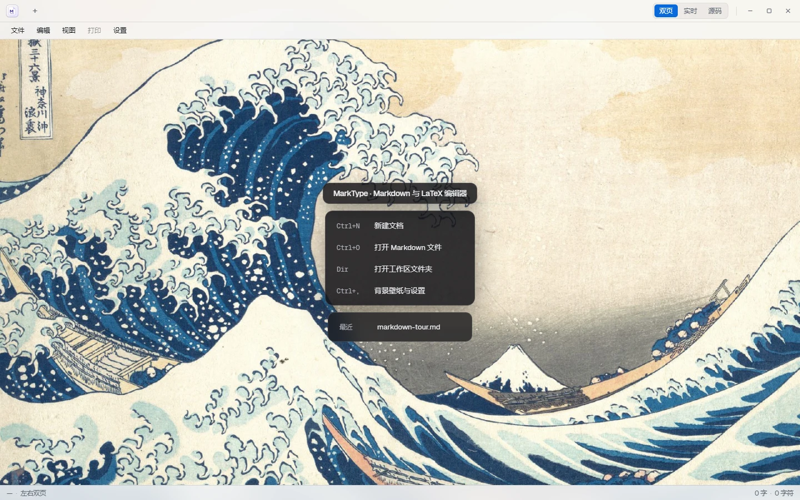
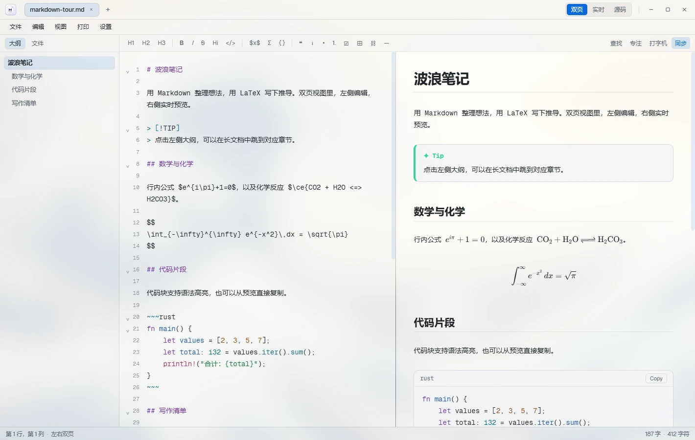
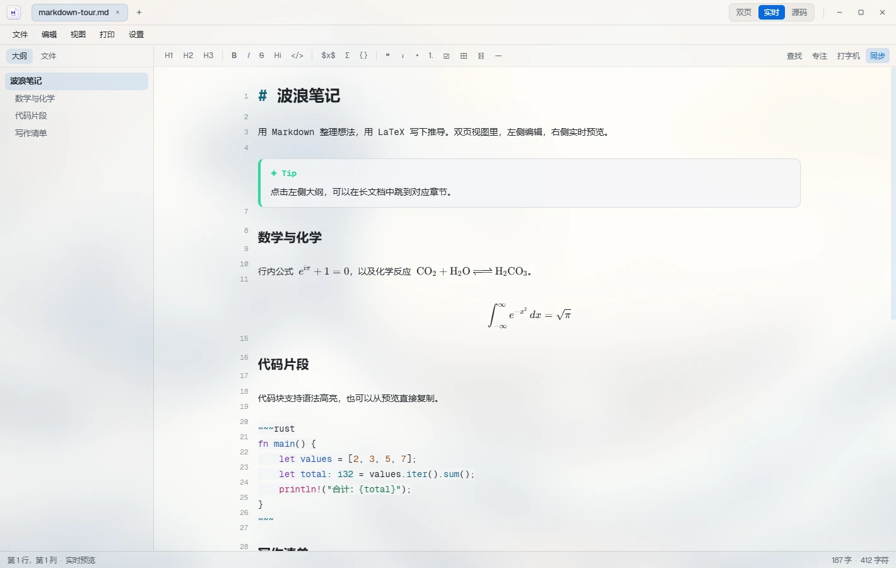
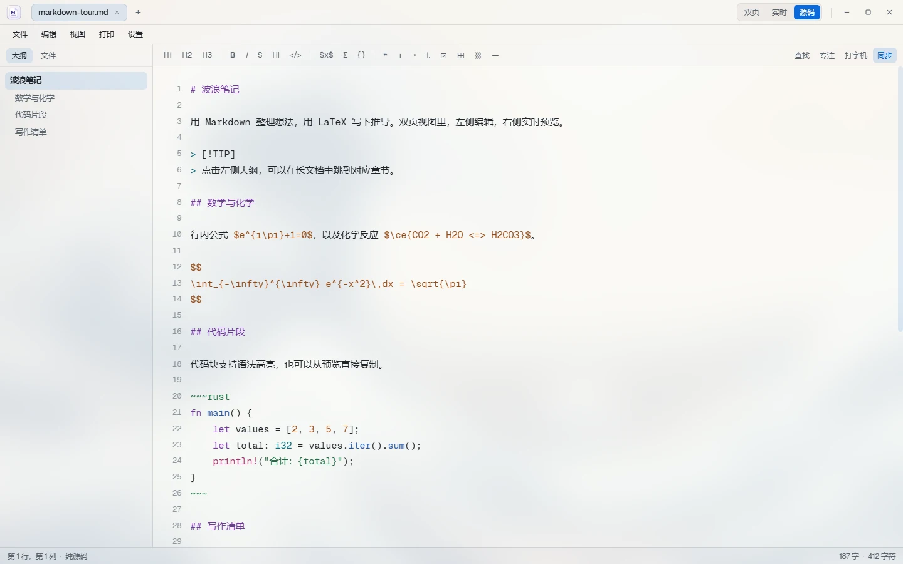
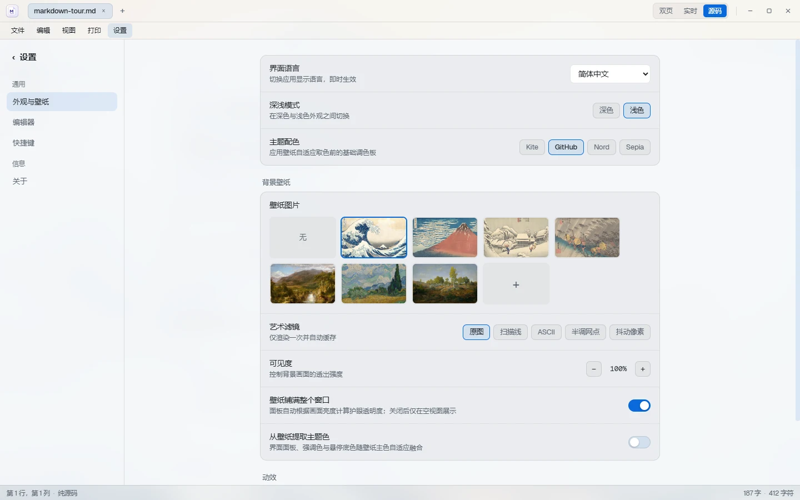
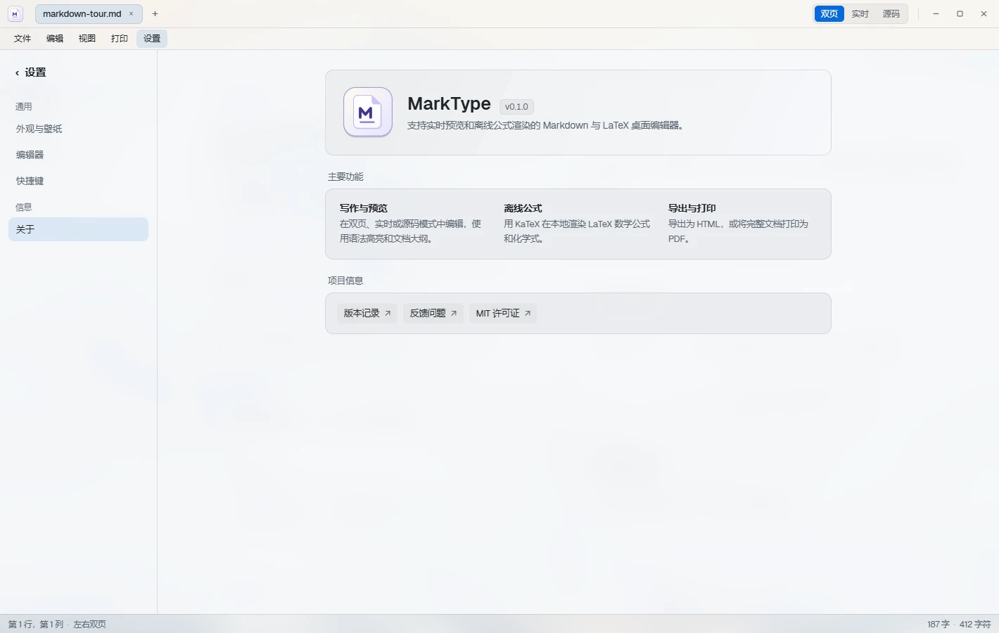

<div align="center">


# MarkType

A desktop Markdown and LaTeX editor for Windows, macOS, and Linux.

[简体中文](README.md) · **English** · [Releases](https://github.com/microcrystallization/marktype/releases)

</div>



## Three editing views

- **Split** shows syntax-highlighted Markdown alongside an updating preview with support for synchronized scrolling, an outline, GFM tables, task lists, and GitHub alerts.
- **Live Preview** lets you edit directly in CodeMirror 6. The current line keeps its Markdown markers while other lines can display headings, emphasis, task checkboxes, and LaTeX in place.
- **Source** gives you a full-width Markdown editor for working on the document structure. The line-number setting applies to all three views.





### More screenshots

All screenshots use the light GitHub theme and The Great Wave wallpaper. The document is the [Markdown and LaTeX tour](examples/markdown-tour.md).

<details>
<summary>Source editor, appearance settings, and About</summary>







</details>

## Writing and export

- Bundled KaTeX, `mhchem`, and math fonts render equations and chemical notation offline.
- Tabs, a file tree, find and replace, autosave, HTML export, and printing to PDF through the system dialog.
- Large files load in source and preview windows. Live Preview draws content near the viewport and sends edit ranges to Rust's Rope text buffer.
- Seven public-domain artworks, custom wallpapers, and light and dark themes.

| Action | Shortcut |
| --- | --- |
| Split / Live Preview / Source | `Ctrl+\` / `Ctrl+/` / `Ctrl+Shift+/` |
| New / Open / Save | `Ctrl+N` / `Ctrl+O` / `Ctrl+S` |
| Find / Replace | `Ctrl+F` / `Ctrl+H` |
| Settings / Print | `Ctrl+,` / `Ctrl+P` |

Use `⌘` on macOS.

## Install

Download the Windows, macOS, and Ubuntu packages and their SHA-256 checksums from the [v0.1.0 release](https://github.com/microcrystallization/marktype/releases/tag/v0.1.0).

| Platform | Installation |
| --- | --- |
| Windows 10/11 x64 | Run `MarkType-Setup-<version>-x64.exe` or extract the portable ZIP. Microsoft Edge WebView2 Runtime is required. |
| macOS 13.3+ | Choose the `macos-arm64.dmg` or `macos-x64.dmg` for your Mac, then drag MarkType into Applications. The app is ad-hoc signed and has no Apple notarization. |
| Ubuntu 24.04 x64 | Run `sudo apt install ./MarkType-<version>-linux-amd64.deb`. |

## Build and release

Install the stable Rust toolchain. On Ubuntu 24.04, install `libgtk-3-dev libwebkit2gtk-4.1-dev`. On macOS, install the Xcode command line tools. Windows packaging requires Inno Setup.

```sh
cargo test --locked --release
cargo run --locked --release -- examples/markdown-tour.md
```

| Package | Command |
| --- | --- |
| Windows installer and portable ZIP | `.\scripts\build-installer.ps1` |
| macOS DMG | `bash scripts/build-macos.sh` |
| Linux DEB | `bash scripts/build-linux.sh` |

[CI](https://github.com/microcrystallization/marktype/actions/workflows/ci.yml) runs checks, tests, and desktop smoke tests. Run [Desktop packages](https://github.com/microcrystallization/marktype/actions/workflows/release.yml) manually for build artifacts. Pushing a new `v*` tag that matches the version in `Cargo.toml` creates a GitHub Release with packages and a SHA-256 checksum file.

The application embeds CodeMirror and KaTeX. When changing the live editor, use Node.js 24 to run `npm ci` and `npm run build:live`, then commit the updated offline bundle.

## License

[MIT](LICENSE). See [NOTICE.md](NOTICE.md) for attributions for fonts, math rendering, the editor, and wallpapers.
