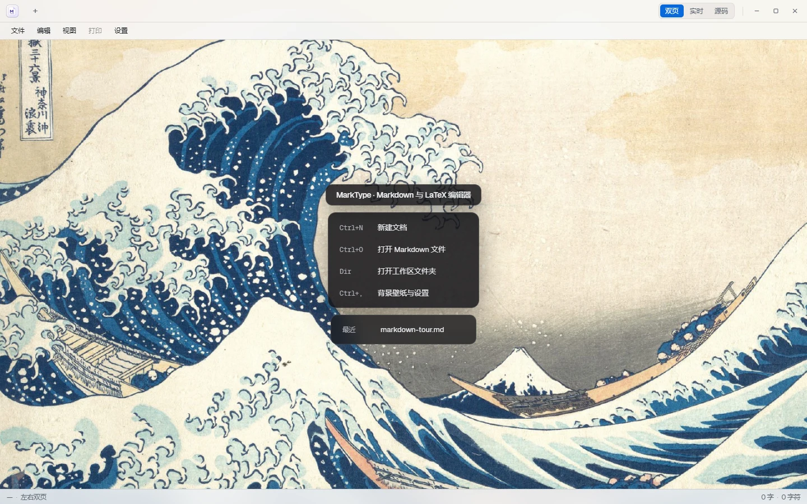
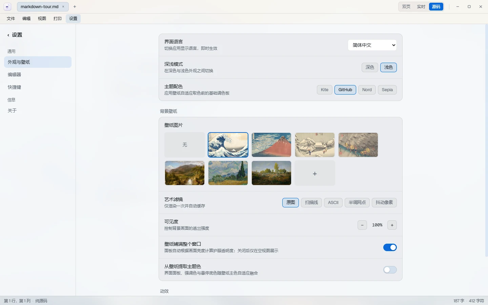

<div align="center">


# MarkType

面向 Windows、macOS 和 Linux 的 Markdown 与 LaTeX 桌面编辑器。

**简体中文** · [English](README.en.md) · [Releases](https://github.com/microcrystallization/marktype/releases)

</div>



## 三种编辑视图

- **双页**并排显示带语法高亮的 Markdown 源码和实时预览。支持文档大纲、同步滚动、GFM 表格、任务列表和 GitHub 提示框。
- **实时预览**在 CodeMirror 6 中直接编辑文档。光标所在行保留 Markdown 标记，其他行可就地显示标题、强调、任务复选框和 LaTeX 公式。
- **源码**提供全宽 Markdown 编辑器，适合集中修改文档结构。双页、实时预览和源码视图都可以在设置里隐藏行号。


### 更多界面

以下实拍均使用 GitHub 浅色主题和《神奈川冲浪里》壁纸。示例文档为 [波浪笔记](examples/markdown-tour.md)。

<details>
<summary>源码编辑、外观设置与关于页面</summary>





</details>

## 写作与导出

- 内置 KaTeX 和 `mhchem`。数学公式、化学式和所需字体均可离线使用。
- 支持多标签、文件树、文档内查找替换、自动保存、导出 HTML 和通过系统打印对话框保存 PDF。
- 大文件按窗口载入源码和预览。实时编辑器只绘制视口附近的内容，并把修改范围同步给 Rust 的 Rope 文本缓冲区。
- 内置七幅公共领域画作，支持导入壁纸和切换深浅主题。

| 操作 | 快捷键 |
| --- | --- |
| 双页 / 实时预览 / 源码 | `Ctrl+\` / `Ctrl+/` / `Ctrl+Shift+/` |
| 新建 / 打开 / 保存 | `Ctrl+N` / `Ctrl+O` / `Ctrl+S` |
| 查找 / 替换 | `Ctrl+F` / `Ctrl+H` |
| 设置 / 打印 | `Ctrl+,` / `Ctrl+P` |

macOS 上使用 `⌘`。

## 安装

已发布的 [v0.1.1](https://github.com/microcrystallization/marktype/releases/tag/v0.1.1) 提供 Windows x64 安装程序和便携 ZIP。包含跨平台工作流的分支可从 [Desktop packages](https://github.com/microcrystallization/marktype/actions/workflows/release.yml) 下载相应运行的构建产物。

| 系统 | 安装方式 |
| --- | --- |
| Windows 10/11 x64 | 运行 `MarkType-Setup-<版本>-x64.exe`，或解压便携 ZIP。需要 Microsoft Edge WebView2 Runtime。 |
| macOS 13.3+ | 按芯片选择 `macos-arm64.dmg` 或 `macos-x64.dmg`，把 MarkType 拖入「应用程序」。构建采用临时签名，未经 Apple 公证。 |
| Ubuntu 24.04 x64 | 运行 `sudo apt install ./MarkType-<版本>-linux-amd64.deb`。 |

## 源码构建与发布

安装稳定版 Rust 工具链。Ubuntu 24.04 需安装 `libgtk-3-dev libwebkit2gtk-4.1-dev`，macOS 需安装 Xcode 命令行工具。Windows 打包需安装 Inno Setup。

```sh
cargo test --locked --release
cargo run --locked --release -- examples/markdown-tour.md
```

| 构建产物 | 命令 |
| --- | --- |
| Windows 安装程序与便携 ZIP | `.\scripts\build-installer.ps1` |
| macOS DMG | `bash scripts/build-macos.sh` |
| Linux DEB | `bash scripts/build-linux.sh` |

[CI](https://github.com/microcrystallization/marktype/actions/workflows/ci.yml) 运行检查、测试和桌面冒烟测试。[Desktop packages](https://github.com/microcrystallization/marktype/actions/workflows/release.yml) 可手动运行以生成产物。推送与 `Cargo.toml` 中版本一致的新 `v*` 标签，会创建 GitHub Release 并上传安装包和 SHA-256 校验文件。

应用内置 CodeMirror 和 KaTeX。修改实时编辑器后，用 Node.js 24 运行 `npm ci`、`npm run build:live`，并提交更新的离线 bundle。

## 许可证

[MIT](LICENSE)。字体、公式渲染、编辑器和壁纸的来源见 [NOTICE.md](NOTICE.md)。
