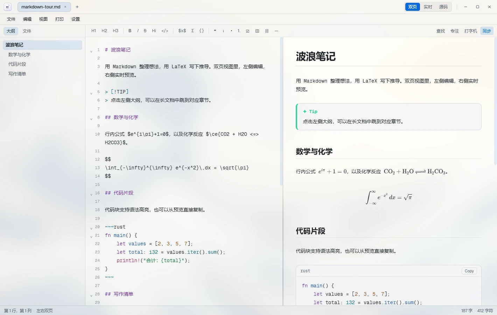
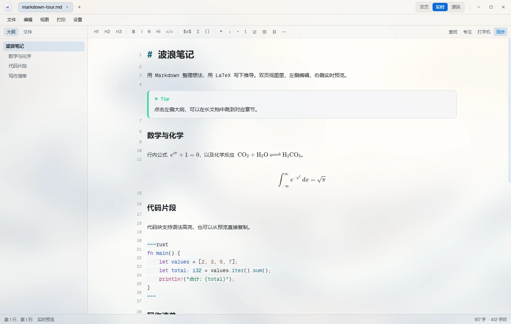
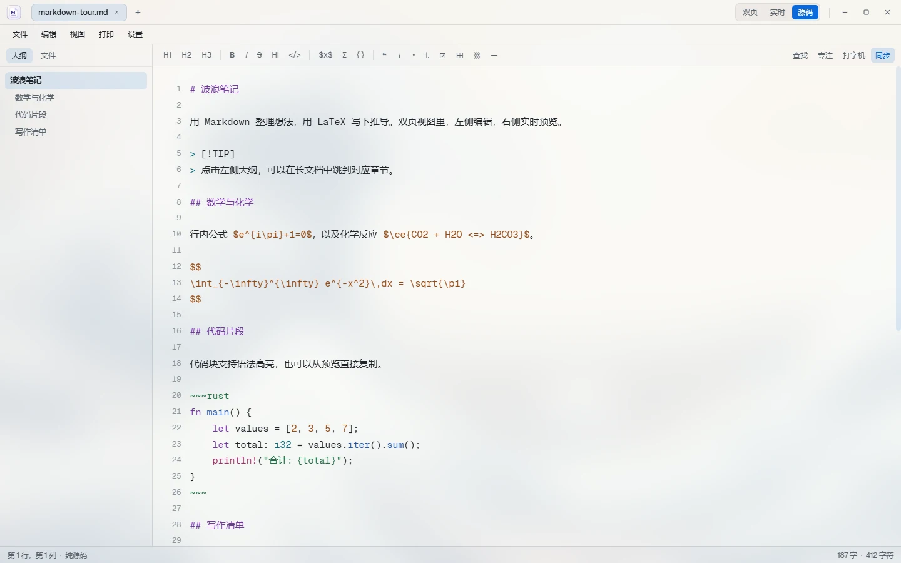
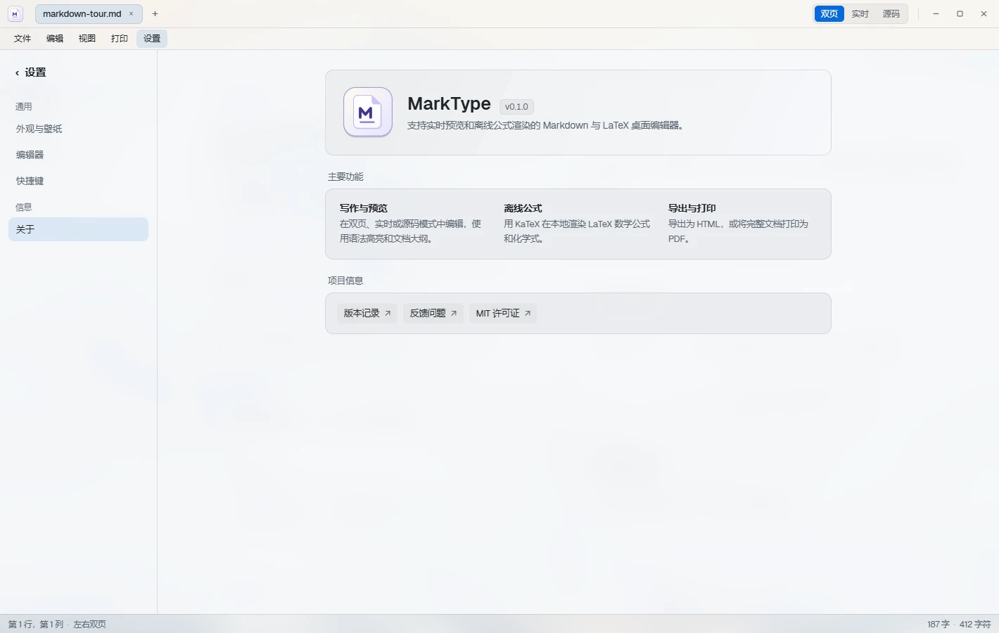

<div align="center">


# MarkType

面向 Windows、macOS 和 Linux 的 Markdown 与 LaTeX 桌面编辑器。

**简体中文** · [English](README.en.md) · [Releases](https://github.com/microcrystallization/marktype/releases)

</div>


## 三种编辑视图

- **双页**并排显示带语法高亮的 Markdown 源码和实时预览。支持文档大纲、同步滚动、GFM 表格、任务列表和 GitHub 提示框。
- **实时预览**在 CodeMirror 6 中直接编辑文档，就地显示图片、GFM 表格、链接文字、GitHub 提示框和 LaTeX 公式。光标触碰某个元素时展开它的 Markdown。同一行的其他元素保持渲染。代码块支持 Rust、JavaScript、TypeScript、Python、C++、Go、Bash、JSON 和 YAML 高亮。
- **源码**提供全宽 Markdown 编辑器，适合集中修改文档结构。双页、实时预览和源码视图都可以在设置里隐藏行号。





### 更多界面

以下实拍均使用 GitHub 浅色主题和《神奈川冲浪里》壁纸。示例文档为 [波浪笔记](examples/markdown-tour.md)。

<details>
<summary>源码编辑、外观设置与关于页面</summary>






</details>

## 写作与导出

- 双页、实时预览和源码共用 CodeMirror 6，支持跨视图撤销、多光标、代码折叠和查找高亮。
- 粘贴剪贴板图片会在文档旁的 `assets/` 保存副本，并插入相对链接。未命名文档会先打开保存对话框。
- 文件在磁盘上变更时，可以重新加载或保留编辑器版本。应用会恢复上次打开的标签、未保存草稿与窗口位置和尺寸。
- 在文件树上右键即可新建、重命名、移到回收站，或在系统文件管理器中显示。`Ctrl+Shift+F` 搜索工作区文本。
- Mermaid 图表支持离线渲染。导出 HTML 时可选择内联本地图片。如果系统已安装 Pandoc，也可导出 Word 和 LaTeX。
- 内置 KaTeX 和 `mhchem`。数学公式、化学式和所需字体均可离线使用。
- 支持多标签、文件树、文档内查找替换、自动保存、导出 HTML 和通过系统打印对话框保存 PDF。
- 大文件按窗口载入源码和预览。实时编辑器只绘制视口附近的内容，并把修改范围同步给 Rust 的 Rope 文本缓冲区。
- 内置七幅公共领域画作，支持导入壁纸和切换深浅主题。

## 编译 LaTeX 论文

1. 安装含 `latexmk` 的 TeX Live、MacTeX 或 MiKTeX，并确保 MarkType 能找到所需的编译器。也可以安装 Tectonic。Windows 上的 `latexmk` 可能还需要 Perl。
2. 在 MarkType 中打开 `.tex` 或工程文件夹。打开章节文件时，MarkType 会识别 `% !TeX root = ../main.tex`，也可以在编译对话框里手动选主文件。
3. 按 `Ctrl+Enter`（macOS 用 `⌘↵`），选择编译器并点「保存并编译」。可以在对话框查看或复制日志，编译成功后会在编辑器右侧的内置 PDF 阅读器中自动打开或刷新主文件旁的同名 PDF（也支持通过系统默认应用外部打开）。
4. **SyncTeX 双向定位**：编译自动生成 `.synctex.gz`。按 `Ctrl+Alt+J`（macOS 用 `⌘⌥J`）或点击「定位到 PDF」从源码光标高亮定位到 PDF 对应区域；在内置 PDF 页面上双击或 `Ctrl+点击`（macOS 用 `⌘+点击`）即可反向跳转并打开对应的 `.tex` 章节文件与行号。

支持 pdfLaTeX、XeLaTeX、LuaLaTeX 和 Tectonic。自动模式识别主文件的 `% !TeX program` 指令，其余情况优先选择 `latexmk` + pdfLaTeX，找不到时使用 Tectonic。`latexmk` 可按工程依赖重复编译并调用 BibTeX 或 Biber，所需宏包和字体由本机 TeX 发行版提供。Tectonic 初次运行可能会下载宏包。编译使用工程目录来解析子文件和图片，临时文件放在独立目录。为避免文档调用外部命令，默认关闭 shell escape 和工程的 `latexmkrc`。

可以用 [示例论文](examples/latex-paper/main.tex) 验证章节、交叉引用、图片和 BibTeX。若示例来自系统安装目录，请先把整个 `latex-paper` 文件夹复制到可写目录。

| 操作 | 快捷键 |
| --- | --- |
| 双页 / 实时预览 / 源码 | `Ctrl+\` / `Ctrl+/` / `Ctrl+Shift+/` |
| 新建 / 打开 / 保存 | `Ctrl+N` / `Ctrl+O` / `Ctrl+S` |
| 查找 / 替换 | `Ctrl+F` / `Ctrl+H` |
| 设置 / 打印 | `Ctrl+,` / `Ctrl+P` |

macOS 上使用 `⌘`。

## 安装

Windows、macOS 和 Ubuntu 的安装包及 SHA-256 校验文件可从 [最新 Release](https://github.com/microcrystallization/marktype/releases/latest) 下载。

| 系统 | 安装方式 |
| --- | --- |
| Windows 10/11 x64 | 运行 `MarkType-Setup-<版本>-x64.exe`，或解压便携 ZIP。需要 Microsoft Edge WebView2 Runtime。 |
| macOS 13.3+ | 按芯片选择 `macos-arm64.dmg` 或 `macos-x64.dmg`，把 MarkType 拖入「应用程序」。构建采用临时签名，未经 Apple 公证。 |
| Ubuntu 24.04 x64 | 运行 `sudo apt install ./MarkType-<版本>-linux-amd64.deb`。 |

## 源码构建与发布

安装稳定版 Rust 工具链。Ubuntu 24.04 需安装 `libgtk-3-dev libwebkit2gtk-4.1-dev`，macOS 需安装 Xcode 命令行工具。Windows 打包需安装 Inno Setup。

```sh
cargo test --locked --release
cargo run --locked --release -- examples/markdown-tour.md
```

| 构建产物 | 命令 |
| --- | --- |
| Windows 安装程序与便携 ZIP | `.\scripts\build-installer.ps1` |
| macOS DMG | `bash scripts/build-macos.sh` |
| Linux DEB | `bash scripts/build-linux.sh` |

[CI](https://github.com/microcrystallization/marktype/actions/workflows/ci.yml) 运行检查、测试和桌面冒烟测试。[Desktop packages](https://github.com/microcrystallization/marktype/actions/workflows/release.yml) 可手动运行以生成产物。推送与 `Cargo.toml` 中版本一致的新 `v*` 标签，会创建 GitHub Release 并上传安装包和 SHA-256 校验文件。

应用内置 CodeMirror、KaTeX、Mermaid 和 PDF.js。用 Node.js 24 运行 `npm ci`，通过 `npm run build:live`、`npm run build:diagrams` 和 `npm run build:pdf` 更新相应的离线资源。

在配置了 Apple Developer ID 和 `notarytool` 认证的 Mac 上，可以给 `scripts/build-macos.sh` 传入 `MARKTYPE_MACOS_IDENTITY` 和 `MARKTYPE_NOTARY_PROFILE`，生成已签名并附带公证票据的 DMG。

## 许可证

[MIT](LICENSE)。字体、公式渲染、编辑器和壁纸的来源见 [NOTICE.md](NOTICE.md)。
