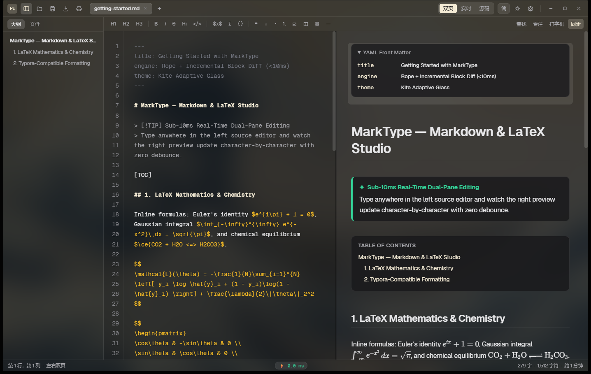
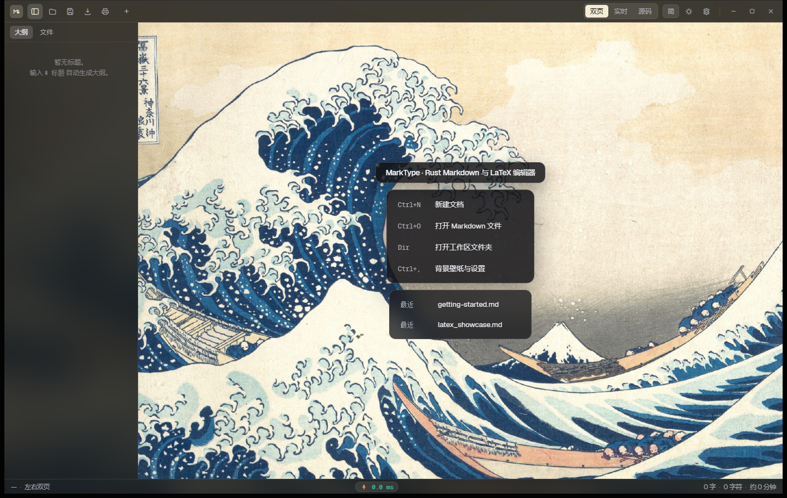

<div align="center">

# MarkType

**A Windows Markdown and LaTeX editor with a live preview, large-file navigation, and adaptive wallpaper themes.**

[](https://www.rust-lang.org)
[](LICENSE)
[](https://github.com)

</div>

---



## Highlights

- **Incremental split preview (Ctrl+\\)**: Edits update a Rope text buffer, reparse the surrounding Markdown blocks, and reuse unchanged preview elements. The source highlighter updates changed lines. Larger documents use a source window and load nearby preview blocks as you navigate.
- **Typora-Compatible Writing Experience**:
  - **Three View Modes**: Real-time **Split** (`Ctrl+\`), **Live WYSIWYG** (`Ctrl+/`), and **Source** (`Ctrl+Shift+/`).
  - **Offline KaTeX + `mhchem`**: Inline `$...$`, display `$$...$$`, `\(...\)`, `\[...\]`, `\begin{align/pmatrix/cases}`, and chemistry `\ce{...}` bundled completely offline with all `.woff2` math fonts.
  - **Rich Extensions**: YAML Front Matter cards, `[TOC]`, GitHub Callouts (`[!NOTE]`, `[!TIP]`, `[!IMPORTANT]`, `[!WARNING]`, `[!CAUTION]`), `==highlight==`, `^sup^`, `~sub~`, GFM tables, footnotes, interactive clickable task checkboxes, local relative image loading, and zero-regex Rust syntax highlighting.
  - **Productivity**: Outline & File Tree sidebar (`Ctrl+Shift+L`), multi-tab documents, Focus Mode (`F8`), Typewriter Mode (`F9`), bidirectional synchronized scrolling, document-wide regex Find & Replace (`Ctrl+F` / `Ctrl+H`), per-document Auto-Save, HTML export with embedded KaTeX fonts, and full-document Print/PDF (`Ctrl+P`).
- **Kite-Inspired Wallpaper & Adaptive Theme System (`Ctrl+,`)**:
  - Includes **7 public-domain classical artworks** from The Metropolitan Museum of Art Open Access (migrated from [Kite](https://github.com/Kfkcome/kite)) plus custom PNG/JPEG/WebP import and history.
  - **5 cached pixel effects**: `None`, `Scanlines`, `ASCII`, `Halftone`, `Dither`.
  - **WCAG Contrast Guard**: Automatically computes frosted glass panel opacity (`0.55–0.92`) from the wallpaper's 2nd–98th percentile brightness and tints surfaces/accents toward the dominant colour while preserving WCAG AA text contrast.
  - **180 ms Cubic-Bezier Crossfade** and a full-bleed sharp Hero Welcome View:



- **Seamless Frameless Native Window**: Integrated custom titlebar with Windows 11 DWM rounded corners, subtle drop shadow, drag-to-move, double-click maximize, and 8-direction edge resizing.
- **6 Languages Built-In**: Live switching with zero restart — `简体中文`, `繁體中文`, `English`, `日本語`, `한국어`, `Français`.

## Performance checks

The Release test suite includes a 50,000-line fixture with 20,000 blocks. The benchmark prints the Rust time for opening and indexing the fixture and applying a single-character edit. WebView layout, scripting, and paint are measured separately from this benchmark.

## Keyboard Shortcuts

| Action | Shortcut |
| :--- | :--- |
| Split Dual-Pane View | `Ctrl + \` |
| Typora Live WYSIWYG Mode | `Ctrl + /` |
| Source Code Mode | `Ctrl + Shift + /` |
| Toggle Sidebar (Outline / Files) | `Ctrl + Shift + L` |
| New / Open / Save | `Ctrl + N` / `Ctrl + O` / `Ctrl + S` |
| Find & Replace | `Ctrl + F` / `Ctrl + H` |
| Bold / Italic / Link / Inline Code | `Ctrl + B` / `Ctrl + I` / `Ctrl + K` / `` Ctrl + ` `` |
| Inline / Display LaTeX | `Ctrl + M` / `Ctrl + Shift + M` |
| Code Block / Table / Headings 1–6 | `Ctrl + Shift + K` / `Ctrl + T` / `Ctrl + 1..6` |
| Focus Mode / Typewriter Mode | `F8` / `F9` |
| Settings & Wallpaper | `Ctrl + ,` |
| Print / Export PDF | `Ctrl + P` |

## Installation

### Windows Installer (Recommended)

Download and run the **`MarkType-Setup-<version>-x64.exe`** installer from a tagged [release](https://github.com/microcrystallization/marktype/releases) or the [Windows packages workflow](https://github.com/microcrystallization/marktype/actions/workflows/release.yml). You can also build it locally via `.\scripts\build-installer.ps1`. The wizard supports 6 languages, per-user or all-users installation, Start Menu & Desktop shortcuts, `.md` / `.markdown` file association, and Explorer right-click `"Open with MarkType"`.

### Build from Source

### Prerequisites
- Rust toolchain (Edition 2024, `rustc >= 1.88`)
- Windows 10/11 with Microsoft Edge WebView2 Runtime (pre-installed on modern Windows)

### Build & Run

```powershell
# Run integration tests (including 50,000-line incremental benchmark)
cargo test --locked --release -- --nocapture

# Build and launch with Cargo's WebView2 loader path
cargo run --locked --release -- examples/getting-started.md

# Build Windows Setup Installer (.exe) + Portable ZIP (requires Inno Setup 6/7)
.\scripts\build-installer.ps1

# Launch the binary after packaging copies WebView2Loader.dll
.\target\release\marktype.exe
.\target\release\marktype.exe examples\getting-started.md
```

CI runs Rust formatting, Clippy, Release tests, the Windows build, and JavaScript syntax checks on `main` and pull requests. Run **Windows packages** in the Actions tab for an installer, portable ZIP, and SHA-256 checksums. Pushing a version tag such as `v0.1.0` publishes those files to the private repository’s Releases page.

Both workflows restore the same Windows Release dependency cache. Successful pushes to `main` populate it for future CI and packaging runs. The cache follows the Rust toolchain and lockfile, and package files are uploaded as artifacts.

## Project Structure

```text
marktype/
├── src/
│   ├── lib.rs                 # Library crate exports
│   ├── main.rs                # Frameless tao + wry window, DWM chrome & IPC loop
│   ├── engine.rs              # Rope buffer & incremental block diff engine
│   ├── markdown.rs            # CommonMark + GFM + LaTeX + Typora renderer
│   ├── highlight.rs           # Single-pass Rust code syntax highlighter
│   ├── ipc.rs                 # App state, tabs, file tree, dialogs & IPC router
│   ├── settings.rs            # Persistent JSON configuration
│   ├── assets.rs              # Embedded UI, KaTeX, fonts & custom protocol handler
│   └── wallpaper/             # Kite-inspired wallpaper effects, caching & WCAG tinting
├── ui/                        # Embedded HTML, CSS, 6-language i18n & JS
├── assets/                    # Bundled KaTeX, Geist fonts & 7 CC0 artworks
├── tests/                     # Standalone Rust integration tests & fixtures
├── examples/                  # Sample Markdown + LaTeX documents
└── docs/screenshots/          # Application screenshots
```

## Credits & License

Licensed under the [MIT License](LICENSE). See [NOTICE.md](NOTICE.md) for third-party attributions including the 7 public-domain Met Open Access artworks migrated from [Kite](https://github.com/Kfkcome/kite), Geist fonts, and KaTeX.
